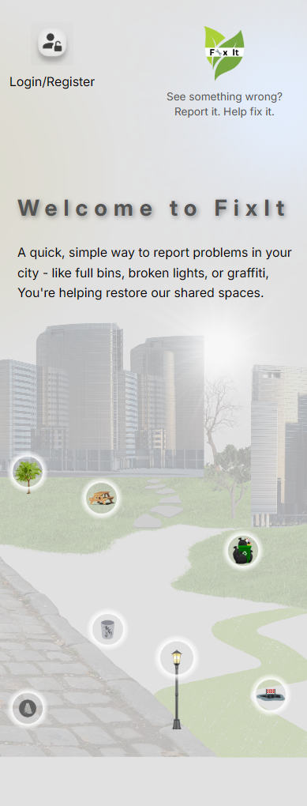
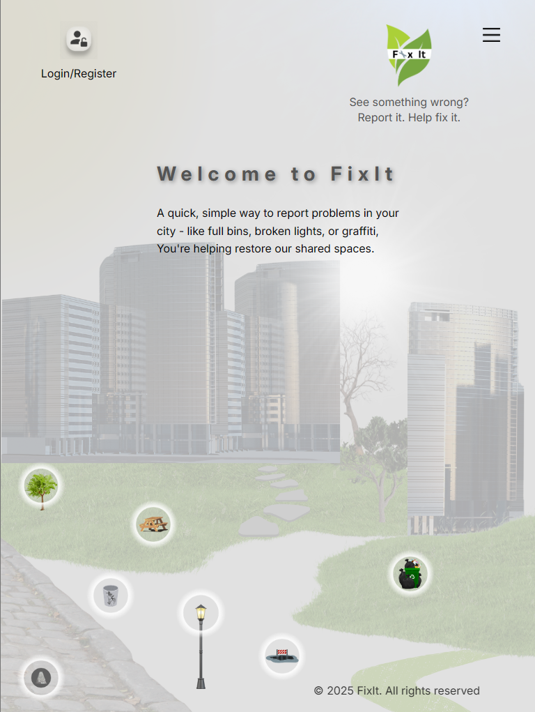
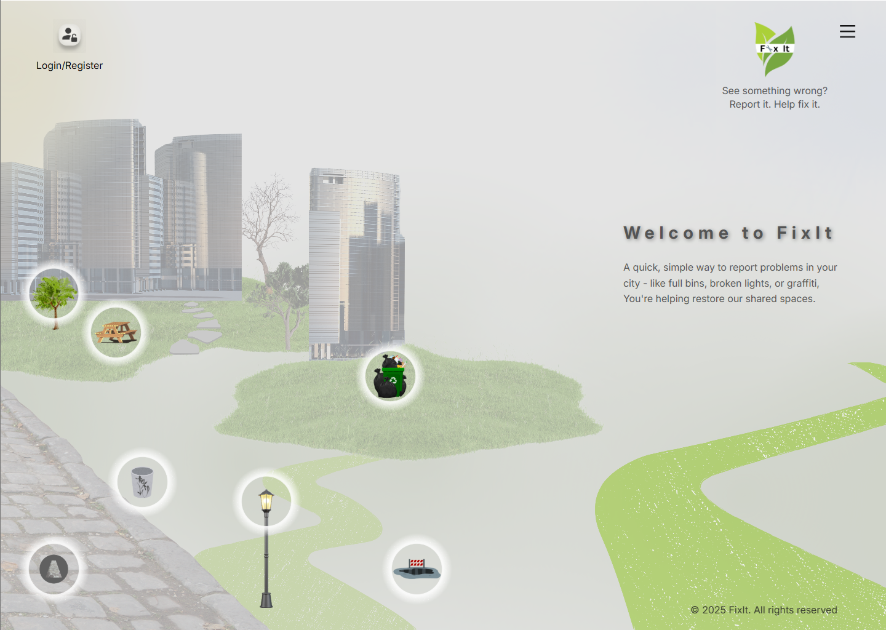
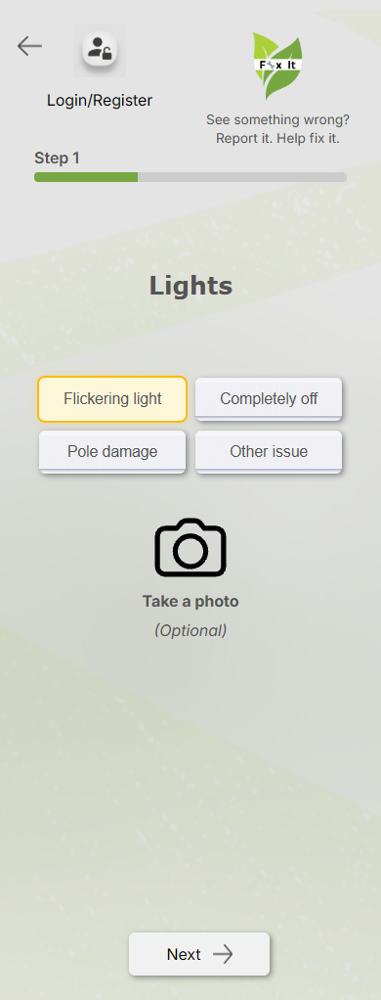
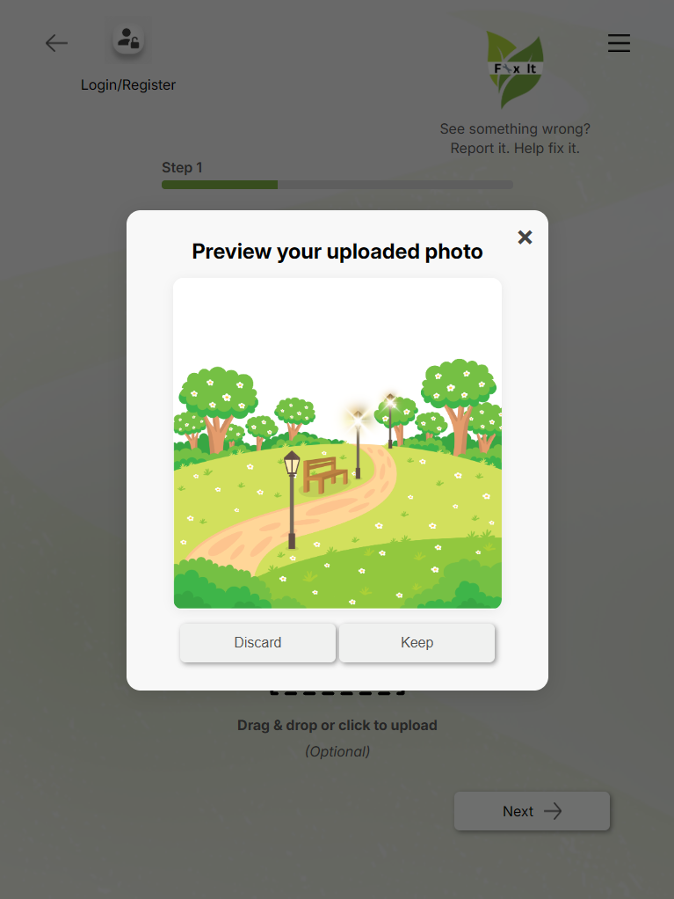
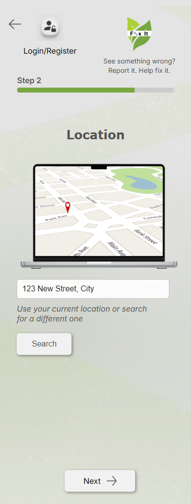
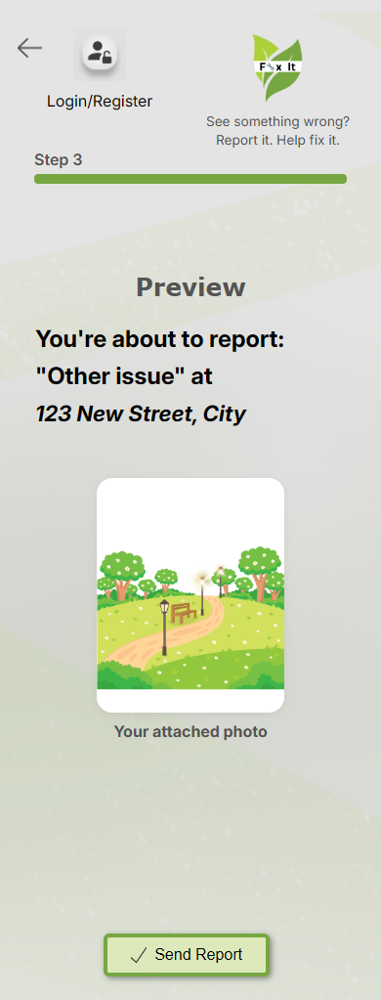
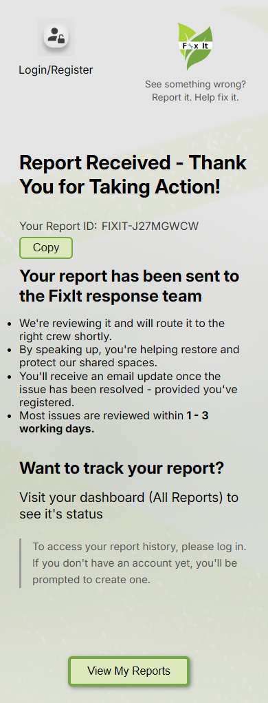
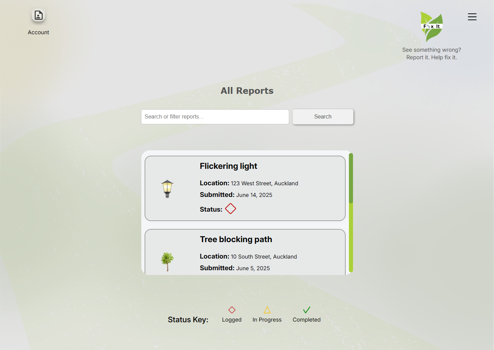

# FixIt — Community Issue Reporting Prototype

## Overview

FixIt is a responsive frontend prototype designed to help people report issues in public spaces, such as broken streetlights, damaged benches and fallen trees.

The application guides users through a simple reporting process, from selecting an issue and providing a location to previewing their report and receiving a confirmation reference.

This project was developed as part of my **Mission Ready frontend development training in 2025**, combining UX/UI design with HTML, CSS and JavaScript.

## Project Goal

Design and develop a user-friendly reporting experience that makes it easier for people to identify and report problems in their local community.

The project focused on clear navigation, straightforward interactions, accessibility and layouts that adapt across mobile, tablet and desktop screens.

## Features

- Interactive Home screen with links to the Lights, Benches and Trees reporting screens.
- Multi-step reporting process for lights, benches and trees.
- Issue selection with visual feedback.
- Other Issue text input with character counter and validation.
- Image upload through file selection or drag-and-drop.
- Photo preview modal with options to keep or discard the image.
- Ability to remove an uploaded image.
- Manual address entry.
- Report preview displaying the selected issue, location and attached photo.
- Temporary preservation of report information during parts of the reporting journey.
- Confirmation screen with a generated report reference ID.
- Copy Report ID button with confirmation feedback.
- All Reports demonstration screen with example reports and status indicators.

## UX/UI Design Process

The project followed a user-centred design approach, including:

- Project brief, goals and requirements.
- Target users and user journeys.
- User flows and navigation planning.
- Wireframes.
- Mobile and desktop interface designs.
- High-fidelity screens and interaction states.
- Responsive layout development.
- Accessibility considerations.

The design documentation includes user flows, reporting journeys, responsive layouts and proposed features for future implementation.

## Tech Stack

- HTML5
- CSS3
- JavaScript
- Figma — UX/UI design and user flows
- Chrome DevTools — responsive layout testing and debugging
- VS Code — development

## Responsive Design

FixIt was developed to support mobile, tablet and desktop screen sizes, with the main responsive layouts designed and tested from **390px upwards**.

The illustrated Home screen presented a particular challenge because the interactive issue icons needed to remain positioned appropriately as the layout changed across different screen widths.

## Project Scope and Limitations

FixIt is a **frontend prototype**, not a production reporting service.

The implemented reporting journey demonstrates user interactions, form validation, photo handling, report previews and confirmation feedback. Reports are not submitted to a live service or saved in a database.

The All Reports page displays example report data rather than retrieving submitted reports.

The following features were designed or planned but are not fully implemented:

- User login and registration.
- Complete hamburger menu and mobile navigation.
- Unsaved-changes warning when leaving a reporting screen.
- Interactive map and address search.
- Report history navigation and search functionality.
- Persistent report storage and backend integration.
- Additional Home screen issue categories and their reporting pathways.

## Running the Project

1. Clone or download the repository.
2. Open the project folder in VS Code.
3. Open `index.html` using Live Server.
4. Select Lights, Benches or Trees from the Home screen to explore the reporting journey.

The `all_reports.html` demonstration page can also be opened directly using Live Server.

No package installation or build process is required.

## Screenshots

### Responsive Home Screen

The illustrated Home screen adapts across mobile, tablet and desktop layouts.

**Mobile — 390px**

**Tablet — 768px**

**Desktop — 1440px**

### Reporting Journey

**Step 1 — Select an Issue**

**Photo Upload and Preview**

**Step 2 — Enter a Location**

**Step 3 — Preview the Report**

**Confirmation and Report Reference**

### All Reports — Demonstration Screen

Example reports with status indicators and a scrollable report list.

## Future Improvements

Potential future development includes:

- Complete user authentication and navigation.
- Map API integration and address search.
- Backend API and database for report submissions.
- Persistent report history and status tracking.
- Unsaved-changes warnings.
- Further responsive layout and accessibility improvements.

## Author

**Shenene Carstens**

Mission Ready — Frontend Development

2025
